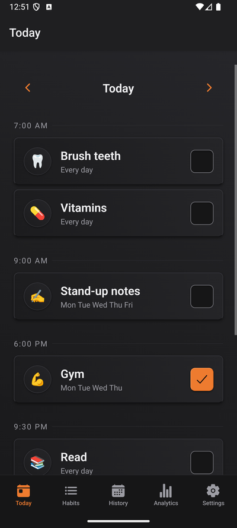
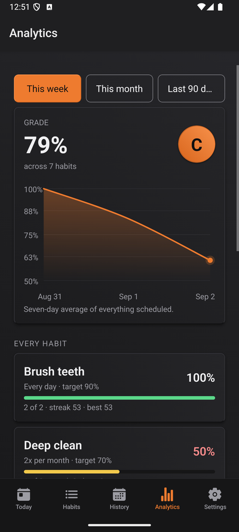
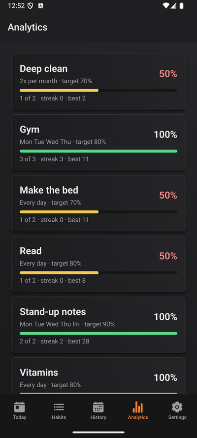
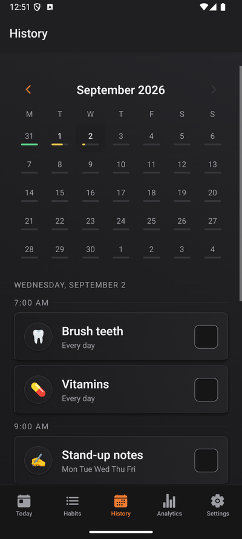
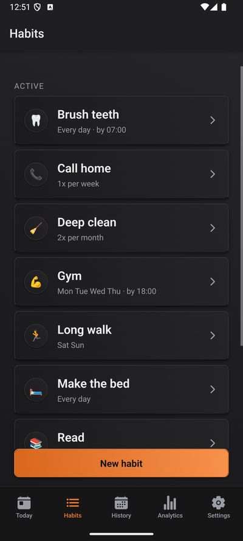
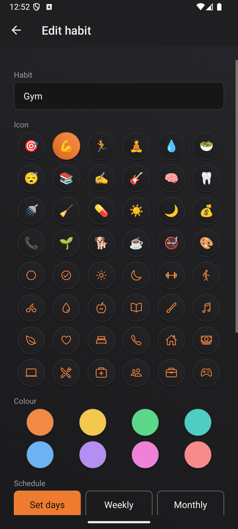
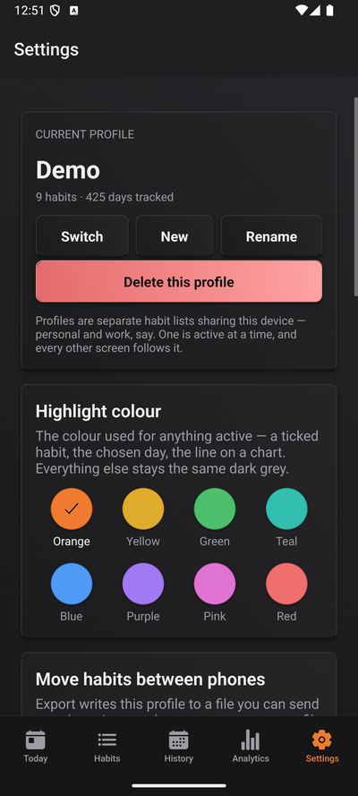

# Groove

A local-only habit tracker for one phone. Habits on the days you actually do them,
reminders that stop nagging once you've ticked the box, and an honest read on how you're
doing.

**Expo SDK 57** · **React Native 0.86** · **React 19** · **TypeScript** ·
**expo-router** · **expo-sqlite** · **Vitest + Jest** · Android

Everything is on the device. No server, no account, no network — which also means a lost
phone loses the data, so the export exists.

<p align="center">
  
  
  
  
</p>

<p align="center">
  
  
  
</p>

## What it does

| Area | Behaviour |
| --- | --- |
| **Habits** | Daily on a weekday mask (*Mon–Thu*, *every Sunday*, *every day*), or a flexible target — *3× a week*, *2× a month* |
| **Today** | Only the habits actually due, grouped by when they're due, ticked with one tap |
| **History** | Any past day is editable — full CRUD over what you did and when. Future days are not |
| **Reminders** | A local notification at the habit's due time, then follow-ups until it's done. Ticking it cancels the rest of the chain; Snooze survives a resync |
| **Analytics** | Completion rate against *scheduled* days, streaks, a grade, and a ninety-day trend |
| **Goals** | A target rate per habit; anything below it surfaces as needing improvement |
| **Profiles** | Separate habit lists — personal, work — one active at a time, uniquely named. No login |
| **Transfer** | Export a profile's habits with or without their history; import a file as a **new** profile, which can never overwrite what you have |
| **Backup** | Export every profile to JSON via the share sheet, and restore it on another phone |
| **Theme** | Dark only, with eight selectable highlight colours — every one contrast-checked |
| **Demo** | One button fills a separate `Demo` profile with ninety days of worked history |

## How it's built

Four decisions carry most of the weight.

**The logic is pure and lives outside the screens.** `date`, `schedule`, `stats`,
`reminder-plan` and `transfer` are plain functions with no React, no SQLite and no
platform in them. `habitsDueOn` decides what's due; Today, the history editor, the
analytics denominators and the notification planner all call the same one. That's why
the test suite runs in under a second in plain Node with no device attached.

**The database enforces the invariants, not the UI.** One completion per habit per day
is a unique index. Unique profile names is a unique index. A habit on no days is a
`CHECK`. Rules enforced in a form rot the moment a second code path appears; these
can't.

**Importing can only ever add.** `importProfiles` creates profiles and never writes into
an existing one, so bringing a file in cannot disturb what's already there — the guard
is the shape of the operation rather than a dialog you can dismiss. The one destructive
import, whole-device Restore, sits apart under *Start over*.

**A schema change saves your data before rebuilding.** There is no migration list: the
schema is authoritative and the database is rebuilt when it changes. That would be a
disaster the first day the app is really used, so `writeRescue` runs first, writing
everything to a file Settings offers to share and Restore takes back.

## Testing

378 tests, all in Node. The interesting part is what they reach:

- **`src/lib`** — the pure modules, directly.
- **`src/lib/db`** — through a `node:sqlite` adapter aliased over `expo-sqlite`, so the
  real SQL runs against a real database.
- **`src/lib/reminders`** — through an in-memory notification scheduler that can freeze a
  sync mid-teardown, which is the only way to test the races that live there.

Both harnesses are deliberately faithful rather than convenient, and both caught
themselves being wrong first:

- The SQLite adapter originally used Node's default of foreign keys **on**. SQLite
  leaves them off, and so does expo-sqlite on the second connection it opens for an
  exclusive transaction — so the first draft passed against a codebase where every
  `ON DELETE CASCADE` was silently inert on a real device.
- The notification harness originally waited "a microtask or two" before simulating a
  tick, which let the sync read the tick it was supposed to be racing. It passed against
  the unfixed code too.

A harness that's convenient rather than faithful is worse than none, because it turns an
unknown risk into false confidence. Both fidelity details are written down in
[CLAUDE.md](CLAUDE.md) so they don't get simplified away later.

## Deliberately absent

- **No backend, accounts, auth, or network.** That is the point.
- **No light theme.** Dark only, so there is no provider and no runtime switch — the
  highlight colour is the single exception, and it says so.
- **No migration system.** The schema is authoritative and the database is rebuilt to
  match it, after saving what it held.
- **No iOS.** Android-first, and the release tooling signs an APK.

## Running it

See [docs/DEVELOPMENT.md](docs/DEVELOPMENT.md) for the build-and-run loop, and
[docs/RELEASE.md](docs/RELEASE.md) for signing and shipping an APK.

```
npm run verify      # both test suites -> typecheck -> lint -> deadcode -> secrets
npm run doctor      # expo-doctor
npm run android     # the only thing that proves it actually builds
```

`npm run verify` never compiles the Android app. Green means the JavaScript is sound and
the config is valid; it does not mean the app builds or runs. CI assembles a debug build
on every push for exactly that reason.

## Repository

```
src/app         routes (expo-router: the file tree IS the navigation)
src/components  ui/ primitives, pages/ screen-specific
src/lib         pure logic, and db/ around it
src/hooks       useAccent — the one piece of runtime theming
tests           Vitest suites, and support/ for the three test doubles
plugins         Expo config plugins (release signing)
docs            DEVELOPMENT · RELEASE · PALETTE-ARCHIVE · screenshots
```

[CLAUDE.md](CLAUDE.md) is the working guide to the codebase — the invariants, the
platform traps that have already cost something, and the rules a change has to keep.
